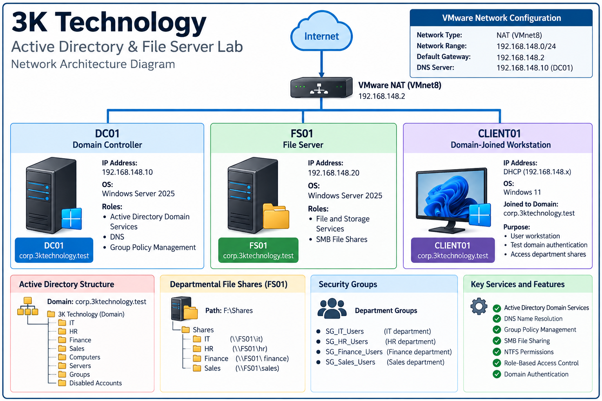

# 3K Technology | Active Directory & File Server Lab

### Windows Server 2025 • Active Directory • Group Policy • DNS • SMB • NTFS • VMware

## Project Overview

Designed and deployed a virtual enterprise IT environment for a fictional organization, **3K Technology**, to gain hands-on experience administering Windows infrastructure.

The environment simulates a small business with four departments: IT, Human Resources, Finance, and Sales.

The project focuses on centralized identity management, domain authentication, security policies, network file sharing, and role-based access control.

## Lab Architecture



| System   | Operating System    | Role                      | IP Address     |
| -------- | ------------------- | ------------------------- | -------------- |
| DC01     | Windows Server 2025 | Domain Controller, DNS    | 192.168.148.10 |
| FS01     | Windows Server 2025 | File Server               | 192.168.148.20 |
| CLIENT01 | Windows 11          | Domain-Joined Workstation | DHCP           |

**Active Directory Domain:** `corp.3ktechnology.test`

**Virtualization Platform:** VMware Workstation

**Network Configuration:** VMware NAT

## Active Directory Configuration

Installed and configured Active Directory Domain Services (AD DS) and DNS on DC01.

Created a structured organizational hierarchy to manage departmental users, computers, servers, and security groups.

### Organizational Units

* IT
* HR
* Finance
* Sales
* Computers
* Servers
* Groups
* Disabled Accounts

### User and Group Management

Created eight employee accounts across four departments.

Configured security groups to manage access to departmental resources:

| Department | Security Group   |
| ---------- | ---------------- |
| IT         | SG_IT_Users      |
| HR         | SG_HR_Users      |
| Finance    | SG_Finance_Users |
| Sales      | SG_Sales_Users   |

Used group-based permissions to simplify access management.

## Group Policy Configuration

Configured Group Policy Objects (GPOs) to implement security settings across the domain.

Policies included:

* Workstation inactivity lock
* Account lockout threshold
* Account lockout duration
* Password complexity requirements
* Password length requirements

Used Group Policy Management and PowerShell to inspect and validate policy configurations.

## File Server Deployment

Deployed FS01 as a dedicated Windows Server 2025 file server.

Added a separate 10GB virtual disk, initialized it using GPT, and formatted it with NTFS.

Created departmental folders on the F: drive:

```text
F:\Shares
├── IT
├── HR
├── Finance
└── Sales
```

Configured SMB network shares for each department.

| Department | Network Share    |
| ---------- | ---------------- |
| IT         | `\\FS01\it`      |
| HR         | `\\FS01\hr`      |
| Finance    | `\\FS01\finance` |
| Sales      | `\\FS01\sales`   |

### File Access Security

Implemented departmental access controls using:

* Active Directory security groups
* NTFS permissions
* SMB share permissions

Configured departmental groups with Modify permissions on their respective folders and Change permissions on their network shares.

Restricted unauthorized access to other departments.

## Security Testing

Performed access control testing from CLIENT01 using the domain account `CORP\jcarter`.

| Test                    | Expected Result | Actual Result |
| ----------------------- | --------------- | ------------- |
| Access IT share         | Allowed         | PASS          |
| Create and save IT file | Allowed         | PASS          |
| Access HR share         | Denied          | PASS          |
| Access Finance share    | Denied          | PASS          |
| Access Sales share      | Denied          | PASS          |

The tests verified that the IT employee could access authorized resources while access to other departments was denied.

## Troubleshooting

Encountered and investigated several issues during deployment, including:

* DNS resolution and connectivity issues
* Domain authentication problems
* File Server role installation failure
* Security group lookup and permission con
